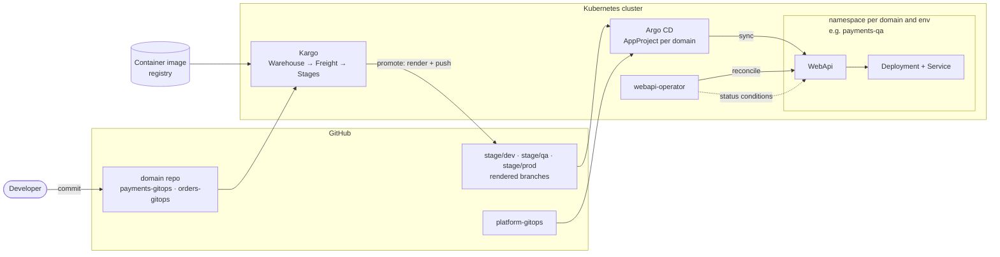

# Platform

An internal developer platform on Kubernetes, built as a proof of concept. Developers describe an application with one small custom resource; the platform runs it, reports its health, and promotes it through dev, qa and prod using GitOps.

This repository is the platform team's GitOps repo and the starting point for the project.

## Start here

- **What a developer writes:** a `WebApi` resource ([example](https://github.com/AaronStahley/payments-gitops/blob/main/manifests/payments-api/base/webapi.yaml)): image, port, probes, resources, replicas.
- **What the platform does:** the [operator](https://github.com/AaronStahley/webapi-operator) turns it into a Deployment and Service and reports `Ready` / `Progressing` / `Degraded`; [Kargo](https://kargo.io) promotes each change dev → qa → prod; [Argo CD](https://argo-cd.readthedocs.io) syncs every environment from Git.
- **Run it locally:** one command, about 10 minutes. See [Run it](#run-it).
- **Why it is built this way:** [docs/decisions.md](docs/decisions.md).

## Architecture



1. A developer changes a `WebApi` in their domain repo, or a new image tag is published.
2. Kargo's Warehouse packages the commit and the image tag as Freight. dev promotes automatically; qa and prod are promoted by hand and only accept Freight that has passed the previous stage.
3. A promotion renders the manifests into the `stage/<env>` branch, so what runs in each environment is a branch you can diff.
4. Argo CD syncs each environment from its branch, inside the domain's AppProject (its own namespaces and repo only).
5. The operator reconciles the `WebApi` into a Deployment and Service and writes status conditions back.

Every change reaches the cluster through Git: nobody runs `kubectl apply` against an environment. Argo CD applies what is in Git, and the operator manages only the objects it derives from a `WebApi`.

## What it does

| Capability | Status |
|---|---|
| `WebApi` CRD with CEL validation (rejects `latest`, requires a port when probes are on) | ✅ [v0.1.0](https://github.com/AaronStahley/webapi-operator/releases/tag/v0.1.0) |
| Rolling-update config and `Ready` / `Progressing` / `Degraded` conditions | ✅ |
| Argo CD app-of-apps for platform and domains, AppProjects as tenant boundaries | ✅ |
| Kargo promotion dev → qa → prod for two sample domains (`payments`, `orders`) | ✅ |
| One-command local cluster (`make all`) | ✅ |

## Repositories

| Repo | Owner (in a real org) | What it holds |
|---|---|---|
| **platform-gitops** (this repo) | Platform team | Argo CD app-of-apps, AppProjects, namespaces, Kargo, the operator per environment |
| [webapi-operator](https://github.com/AaronStahley/webapi-operator) | Platform team | The Go operator, `WebApi` CRD, Helm chart, release image |
| [platform-bootstrap](https://github.com/AaronStahley/platform-bootstrap) | Platform team | Day-0: kind cluster, Argo CD install, credentials, root apps |
| [payments-gitops](https://github.com/AaronStahley/payments-gitops) | Payments team | Sample tenant: podinfo as a `WebApi`, overlays per env, Kargo pipeline |
| [orders-gitops](https://github.com/AaronStahley/orders-gitops) | Orders team | Sample tenant, same shape as payments |

The sample tenants run [podinfo](https://github.com/stefanprodan/podinfo), a small public web service, in place of real team applications.

## Run it

Requirements: Docker (cgroup v2), kind, kubectl, make, and a GitHub token with **Contents: read and write** on the repos above. The [platform-bootstrap README](https://github.com/AaronStahley/platform-bootstrap#github-token) explains the token.

```bash
git clone https://github.com/AaronStahley/platform-bootstrap.git
cd platform-bootstrap
# save the token to .secrets/github_token, then:
make all
kubectl get applications -n argocd
kubectl get webapi -A
```

`make all` creates the cluster, installs Argo CD and hands everything else to this repo. The script prints the Argo CD, Kargo and Grafana URLs and demo logins when it finishes.

## Try a promotion

1. Open the Kargo UI: `kubectl port-forward -n kargo svc/kargo-api 8081:443`, then https://localhost:8081 (demo login `admin` / `admin`).
2. In the **payments** project, dev already holds the newest Freight (it auto-promotes). Promote that Freight to **qa**, then to **prod**.
3. Watch it land:

   ```bash
   kubectl get webapi -A
   kubectl -n payments-qa port-forward svc/payments-api 9898:80   # then open http://localhost:9898
   ```

4. To send a change through the pipeline, edit `PODINFO_UI_MESSAGE` in `payments-gitops/manifests/payments-api/overlays/qa/webapi-patch.yaml` and push to `main`. Kargo creates new Freight, dev picks it up automatically, and the new message appears in qa once you promote it there.

## More docs

- [docs/decisions.md](docs/decisions.md): design decisions and trade-offs
- [docs/MULTI_REPO_SETUP.md](docs/MULTI_REPO_SETUP.md): how domain repos plug in, and adding a domain
- [docs/argocd-guide.md](docs/argocd-guide.md): Argo CD layout, sync waves, adding applications

## License

[Apache-2.0](LICENSE)
